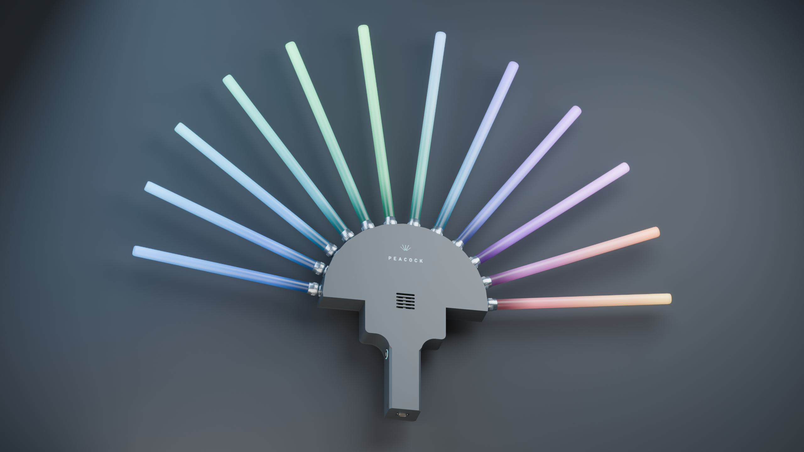

# Kujaku（孔雀）

Kujaku 是一套用于孔雀造型灯光装置的开源硬件与固件设计，包含多路 PWM 主控板、3S 18650 电池与充电板、外壳模型和 ESP32-C3 固件。仓库中的历史文件沿用 Peacock 命名。

## 项目内容

- [主板 V2.1](PeacockMainV2_1/PeacockMainV2_1-Design.md)：KiCad 原理图、PCB、制造文件与设计记录，提供 12 路 PWM 和电流采样。
- [电池板 A2](PeacockBattery/A2/PeacockBattery-Design.md)：3S 电池、充电与握把接口设计，包含制造资料。
- [ESP32-C3 固件](firmware/peacock-esp32c3/README.md)：Rust 固件，包含灯效、音频、BLE 和电源管理；编译、烧录及接口说明见其 README。
- [外壳](PeacockEnclosure/)与[装配效果图](renders/)：DWG、STL、模型导出和渲染图。
- [主板 V2](PeacockMainV2/PeacockMainV2-Design.md)、[电池板 A1](PeacockBattery/PeacockBattery-Design.md)及仓库根目录的 KiCad 工程为历史版本，请按相应版本的文档使用。

## 开始使用

使用 KiCad 10 打开相应目录中的 `.kicad_pro`，并参考各设计记录中的接口、物料和制造说明。外壳模型位于 `PeacockEnclosure/`。固件的工具链、构建和烧录步骤详见[固件说明](firmware/peacock-esp32c3/README.md)。

**项目仍需实物验证。** ERC/DRC 结果不代表整机通过验证；电池接触、充放电保护、温升、装壳及接口兼容性等须按对应版本的设计记录完成验证。固件中的 PY32 采样从机协议仍是提案，仓库未提供该从机固件。制作或上电前请先阅读相关设计记录。

## 许可

本项目原创固件和其他软件代码采用 [GNU Affero General Public License v3.0](LICENSE)（AGPL-3.0-only）；原创硬件设计、外壳、渲染图及文档采用 [Creative Commons Attribution-ShareAlike 4.0 International](LICENSE-CC-BY-SA-4.0)（CC BY-SA 4.0）。使用设计资料时请署名 Kujaku 项目及相关贡献者，并遵守相同方式共享要求。

第三方材料及依赖仍遵循各自的许可和声明；例如 ESP32 模型相关许可见 [Espressif 许可文件](PeacockMainV2_1/Espressif-LICENSE.md)。上述许可不改变第三方权利。
